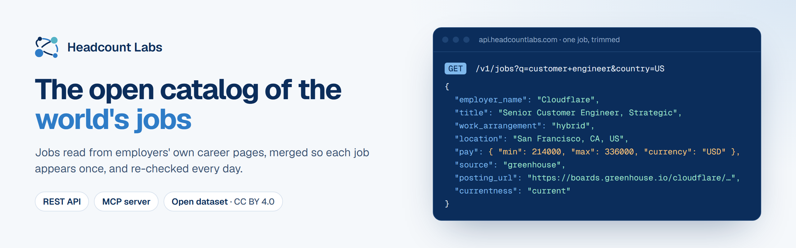
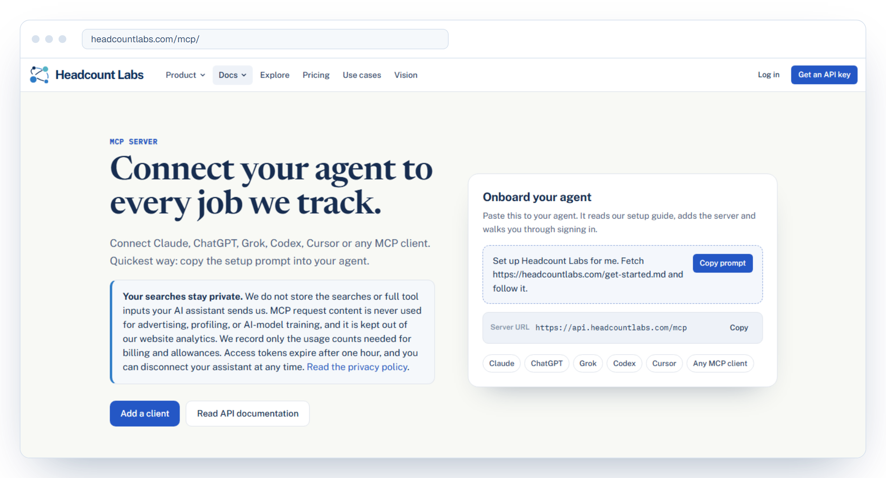
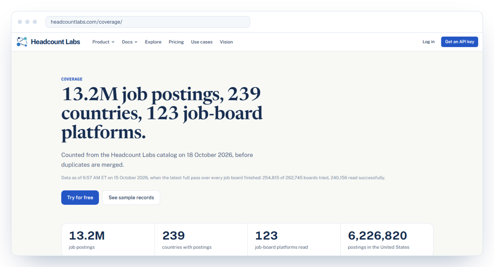

<p align="center">
  <a href="https://headcountlabs.com">
    <picture>
      <source media="(prefers-color-scheme: dark)" srcset="assets/banner-dark.png">
      
    </picture>
  </a>
</p>

<p align="center">
  <a href="https://github.com/HeadcountLabs/job-postings"><b>Star <code>HeadcountLabs/job-postings</code></b></a>: the open dataset of 8.4M job postings, the API and MCP quick start, example queries and how to cite it.
</p>

<p align="center">
  <a href="https://api.headcountlabs.com/data/signup"></a>
  <a href="https://headcountlabs.com/mcp/"></a>
  <a href="https://huggingface.co/datasets/HeadcountLabs/job-postings"></a>
</p>

<p align="center">
  <a href="https://headcountlabs.com"><b>Website</b></a> ·
  <a href="https://headcountlabs.com/docs/"><b>API docs</b></a> ·
  <a href="https://headcountlabs.com/pricing/"><b>Pricing</b></a> ·
  <a href="https://headcountlabs.com/coverage/"><b>Coverage</b></a> ·
  <a href="https://headcountlabs.com/verification/"><b>Check our data</b></a>
</p>

Most job sites resell the same listings, copied from each other and often weeks out of date.
Headcount Labs goes to the source: the careers page or applicant tracking system (ATS) board of each employer.
We read every posting, merge copies of the same opening into one job, and re-check every job daily.
Each job keeps a link to every original posting, so you can always check it yourself.

## By the numbers

| | |
| ---: | --- |
| **8,365,616** | open jobs in the API, after merging |
| **240,156** | job boards read in the last full pass |
| **241** | countries with postings |
| **131** | job-board platforms read |

<sub>Job count from <code>GET /v1/jobs/count</code> on October 19, 2026 at 5:24 PM ET. Countries and platforms from the <a href="https://headcountlabs.com/coverage/">coverage page</a> on October 19, 2026. The last full pass over every job board finished at 6:57 AM ET on October 15, 2026. The coverage page always has the current count.</sub>

## Pick your way in

| You want to | Use | Start here |
| --- | --- | --- |
| Ask Claude, ChatGPT, Codex, Cursor or another AI assistant about jobs | **MCP server** | `https://api.headcountlabs.com/mcp` ([setup](https://headcountlabs.com/mcp/)) |
| Pull jobs into your own product or pipeline | **REST API** | [Get a key](https://api.headcountlabs.com/data/signup), then `GET /v1/jobs` ([docs](https://headcountlabs.com/docs/)) |
| Study the job market in a notebook or a warehouse | **Open dataset** | [HeadcountLabs/job-postings](https://huggingface.co/datasets/HeadcountLabs/job-postings) on Hugging Face, ODbL 1.0 ([guide and example queries](https://github.com/HeadcountLabs/job-postings)) |
| Find a job | **Website** | [headcountlabs.com](https://headcountlabs.com) |
| Cite job market figures in an article or paper | **Report** | [The US job market in numbers](https://headcountlabs.com/reports/us-job-market/): jobs by state, top employers, pay and remote share, ODbL 1.0 with a CSV |

Browse the data on the site: [job postings datasets by country, state and occupation](https://headcountlabs.com/data/), [salary data from posted pay](https://headcountlabs.com/salary-data/), [open jobs by employer](https://headcountlabs.com/companies/) and [guides to job data APIs](https://headcountlabs.com/guides/).

## Quick start

**Agents.** Paste this into your AI agent. It reads our setup guide, adds the server and walks you through sign-in.

```text
Set up Headcount Labs for me. Fetch https://headcountlabs.com/get-started.md and follow it.
```

**API.** Create a key at [api.headcountlabs.com/data/keys](https://api.headcountlabs.com/data/keys), then:

```bash
curl "https://api.headcountlabs.com/v1/jobs?q=registered+nurse&state=NY&limit=25" \
  --header "Authorization: Bearer $HEADCOUNTLABS_API_KEY"
```

<details>
<summary><b>Add the MCP server to a specific client</b></summary>

<br>

**Claude Code**

```bash
claude mcp add --transport http headcountlabs --scope user https://api.headcountlabs.com/mcp
```

**Codex CLI**

```bash
codex mcp add headcountlabs --url https://api.headcountlabs.com/mcp
```

**Cursor** (`~/.cursor/mcp.json`)

```json
{
  "mcpServers": {
    "headcountlabs": { "url": "https://api.headcountlabs.com/mcp" }
  }
}
```

**Claude Desktop and claude.ai.** Settings, then Connectors, then Add custom connector, with the URL `https://api.headcountlabs.com/mcp`.

**Other clients.** Any client that supports remote MCP servers works. Clients that only run local (stdio) servers can use `npx mcp-remote https://api.headcountlabs.com/mcp`. The [setup guide](https://headcountlabs.com/get-started.md) covers VS Code, Gemini CLI and Windsurf too.

</details>

<p align="center">
  <a href="https://headcountlabs.com/mcp/">
    <picture>
      <source media="(prefers-color-scheme: dark)" srcset="assets/mcp-dark.png">
      
    </picture>
  </a>
</p>

## What you get

- **Jobs from the source.** We read employers' own boards on Workday, Greenhouse, Lever, Ashby, iCIMS, SmartRecruiters, Oracle, SAP SuccessFactors and more than 100 other platforms, plus company career sites.
- **One job, once.** Copies of the same opening on several boards are merged into one job, and the job keeps a link to each original posting.
- **Fields filled where the employer published them.** Pay, location, work arrangement and employment type, with a state on each field that says whether it is known.
- **Fresh.** Every job is re-checked daily. Closed jobs drop out once the next read of their board confirms it.
- **Checkable.** The [verification page](https://headcountlabs.com/verification/) lets anyone count an employer's jobs or compare their own list with ours, free and without an account.

<p align="center">
  <a href="https://headcountlabs.com/coverage/">
    <picture>
      <source media="(prefers-color-scheme: dark)" srcset="assets/coverage-dark.png">
      
    </picture>
  </a>
</p>

## Pricing

Every organization gets **100,000 records free each calendar month** (UTC), with no card needed.
After that, every record delivered costs a flat $0.01 per 1,000, at any volume: 1,000,000 records in a month cost $9, and 3,000,000 cost $29.
The MCP server, the REST API and exports share the same allowance.
See [headcountlabs.com/pricing](https://headcountlabs.com/pricing/) for the full rate card and a calculator.

## Repositories

| Repository | What it is |
| --- | --- |
| [**job-postings**](https://github.com/HeadcountLabs/job-postings) | Start here. The open dataset of 8,367,463 jobs on Hugging Face (ODbL 1.0), with the schema, example DuckDB and pandas queries, a sample file, the API and MCP quick start, and how to cite it |
| [**headcountlabs-mcp**](https://github.com/HeadcountLabs/headcountlabs-mcp) | The hosted MCP server for job postings: setup files for each client, the tool list and examples ([headcountlabs.com/mcp](https://headcountlabs.com/mcp/)) |
| [**claude-plugin**](https://github.com/HeadcountLabs/claude-plugin) | Headcount Labs plugin for Claude Code: ask about open jobs in plain language |
| [**career-ops-plugin-headcountlabs**](https://github.com/HeadcountLabs/career-ops-plugin-headcountlabs) | A [career-ops](https://github.com/career-ops-hq/career-ops) provider and search hook for the jobs API |

## Job lists

Thirty-two open job lists, rebuilt every morning from the API. Each job was still listed on the employer's own board within the past three days, copies are merged, and closed jobs drop off at the next update. Every row has pay and remote status where the employer published them, plus a direct apply link.

| | |
| --- | --- |
| **Internships and new grad** | [Software engineering internships](https://github.com/HeadcountLabs/software-engineering-internships) · [Data, AI and ML internships](https://github.com/HeadcountLabs/data-science-ai-internships) · [Engineering internships](https://github.com/HeadcountLabs/engineering-internships) · [Business and finance internships](https://github.com/HeadcountLabs/business-finance-internships) · [All internships](https://github.com/HeadcountLabs/internships) · [New grad software engineer](https://github.com/HeadcountLabs/new-grad-software-engineer-jobs) · [Entry-level jobs](https://github.com/HeadcountLabs/entry-level-jobs) · [Entry-level data analyst](https://github.com/HeadcountLabs/entry-level-data-analyst-jobs) |
| **Remote** | [All remote jobs](https://github.com/HeadcountLabs/remote-jobs) · [Software engineering](https://github.com/HeadcountLabs/remote-software-engineer-jobs) · [Data](https://github.com/HeadcountLabs/remote-data-jobs) · [Product management](https://github.com/HeadcountLabs/remote-product-manager-jobs) · [Marketing](https://github.com/HeadcountLabs/remote-marketing-jobs) · [Sales](https://github.com/HeadcountLabs/remote-sales-jobs) · [Customer support](https://github.com/HeadcountLabs/remote-customer-support-jobs) · [Healthcare](https://github.com/HeadcountLabs/remote-healthcare-jobs) · [Finance and accounting](https://github.com/HeadcountLabs/remote-finance-accounting-jobs) |
| **By role** | [Tech and software](https://github.com/HeadcountLabs/tech-jobs) · [Jobs with salary listed](https://github.com/HeadcountLabs/pay-transparency-jobs) · [AI and ML engineer](https://github.com/HeadcountLabs/ai-ml-engineer-jobs) · [Data engineer](https://github.com/HeadcountLabs/data-engineer-jobs) · [Cybersecurity](https://github.com/HeadcountLabs/cybersecurity-jobs) · [Product manager](https://github.com/HeadcountLabs/product-manager-jobs) · [Registered nurse](https://github.com/HeadcountLabs/registered-nurse-jobs) · [Software jobs paying $200k+](https://github.com/HeadcountLabs/high-paying-software-jobs) |
| **By city (tech)** | [Bay Area](https://github.com/HeadcountLabs/bay-area-tech-jobs) · [New York](https://github.com/HeadcountLabs/new-york-tech-jobs) · [Seattle](https://github.com/HeadcountLabs/seattle-tech-jobs) · [Austin](https://github.com/HeadcountLabs/austin-tech-jobs) · [Boston](https://github.com/HeadcountLabs/boston-tech-jobs) · [Los Angeles](https://github.com/HeadcountLabs/los-angeles-tech-jobs) · [Washington, DC](https://github.com/HeadcountLabs/washington-dc-tech-jobs) |

## Contact

Questions, missing employers or a job that looks wrong: [headcountlabs.com/contact](https://headcountlabs.com/contact/) or support@headcountlabs.com.
